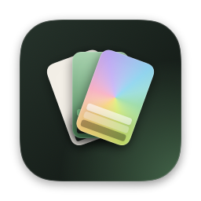

<p align="center">
  
</p>

<h1 align="center">Opaline</h1>

<p align="center">One theme, every app on your Mac.<br>Design a color theme once and apply it to your terminal, editor, browser, Claude Code and wallpaper in one click.</p>

---

Opaline is a native macOS app. A theme is a small JSON file of **color roles** (background layers, text, accent, terminal
palette, syntax). Opaline translates those roles into the config of each app, keeps a snapshot of every file it changes,
and can undo any apply from its History.

- **Apply everywhere**: Ghostty, cmux, Zed, Claude Code, Zen browser, GitHub in Zen, your wallpaper, and any app you add.
- **Edit visually**: every role has a color well, with a live preview of an editor, a terminal, a browser and the wallpaper.
- **Share themes**: export a file, copy the JSON, import by drag and drop or paste. One file, logos included.
- **Make themes with AI**: the format is documented for assistants; paste Claude's answer with **⇧⌘V** and it is installed.
- **Light and dark**: a theme can carry both versions; Zed, the terminal, cmux and the wallpaper follow the Mac's switch.
- **Safe**: config files are edited in place (comments and unrelated settings kept), with a snapshot to restore.

## Install

```sh
brew install --cask arthurmtro/tap/opaline
```

Or download the zip from [Releases](https://github.com/Arthurmtro/Opaline/releases). The app is signed and notarized,
universal (Apple silicon and Intel), and needs macOS 15 or later.

## Apps it themes

| App | What changes |
|---|---|
| Terminal (Ghostty, cmux) | `~/.config/ghostty/themes/<name>`, a glow backdrop image, a marked block in `~/.config/ghostty/config` |
| cmux | accent, sidebar tint, selected workspace and focused pane in `~/.config/cmux/cmux.json` |
| Claude Code | `~/.claude/themes/<id>.json` and `theme` in `~/.claude/settings.json` |
| Zed | `~/.config/zed/themes/<id>.json` and `theme` in `~/.config/zed/settings.json` |
| Zen | workspace gradient (`zen-sessions.jsonlz4`), window scheme (`prefs.js`), the other variant in `chrome/userChrome.css`; Zen restarts for a moment |
| GitHub in Zen | `chrome/userContent.css` of the Zen profile (dark themes) |
| Wallpaper | rendered for each screen's size and set as the desktop picture |
| Your apps | any file, rendered from a template with tokens like `{{palette.accent}}`, plus an optional reload command |

Only apps installed on your Mac are offered; each one can be switched off in **Apps**.

## Themes

Opaline ships with **Opaline**, **Sage**, **Catppuccin Mocha** and **Paper** (light). Built-in themes update with the app;
editing one saves your version, and **Reset** brings the original back.
The gallery has search (⌘F), filters (favorites, your themes, dark, light) and favorites, shown first. Create one with **New Theme**, or
write a file: the smallest valid theme is a name and three colors.

```json
{
  "name": "Ocean Glass",
  "palette": { "base": "#0E1A24", "text": "#E3EEF5", "accent": "#4FC3F7" }
}
```

Every other role is derived from these and can be overridden. Add an `alternate` object with a light (or dark) palette and
the apps that support it switch with macOS. The full reference, design rules and a ready-to-paste
prompt for Claude are in **[docs/THEME_FORMAT.md](docs/THEME_FORMAT.md)**; the JSON Schema is
[schema/theme.schema.json](schema/theme.schema.json).

| To | Do |
|---|---|
| Import a file | drop it on the window, or **File › Import Theme…** (⌘O) |
| Import from a chat | copy the answer, then **File › Paste Theme** (⇧⌘V) |
| Share | **Export › Save as File…** (⌘E) or **Copy JSON** (⇧⌘C) |

## Add any app

**Apps › Add App** writes a file of your choice from a template. Tokens are the theme's JSON paths:

```ini
# ~/.config/kitty/current-theme.conf
background {{palette.base}}
foreground {{palette.text}}
cursor     {{palette.accent}}
color4     {{terminal.ansi.4}}
```

Filters: `{{palette.accent | rgb}}` gives `136, 207, 148`, `| nohash` drops the `#`, `| opaque` drops alpha,
`| upper` and `| lower` change case. Add a reload command (for example `kill -SIGUSR1 $(pgrep kitty)`) and choose
whether the app is closed while writing.

## Build

Requirements: macOS 15+, Xcode 16+ (Swift 6), [XcodeGen](https://github.com/yonaskolb/XcodeGen).

```sh
brew install xcodegen
Scripts/run.sh   # generate the Xcode project, build Debug, launch
swift test       # engine tests (OpalineKit)
```

The app is not sandboxed: it edits dotfiles in your home folder and closes apps that rewrite their files on quit.

[](https://github.com/Arthurmtro/Opaline/actions/workflows/ci.yml)
runs the tests and builds the app on every push and pull request.

## Where things live

`~/Library/Application Support/Opaline/`

| Path | Content |
|---|---|
| `themes/<id>.json` | your themes and your edits of built-in ones, same format as exported files |
| `targets/` | apps you added |
| `snapshots/` | originals of every file an apply replaced, with a manifest |
| `wallpapers/` | rendered wallpapers |
| `state.json` | which theme each app wears |

## Project layout

| Path | Content |
|---|---|
| `Sources/OpalineKit/Model` | `Theme`, the file format, derived defaults, `ThemeStore` |
| `Sources/OpalineKit/Targets` | one adapter per app |
| `Sources/OpalineKit/Engine` | apply, snapshots, restore |
| `Sources/OpalineKit/Rendering` | terminal backdrop, GitHub stylesheet, wallpaper |
| `themes/defaults` | themes shipped with Opaline (tracked) |
| `themes/custom` | your own themes, bundled into your builds, ignored by git |
| `App/Sources` | the SwiftUI app |

## Contributing

See [CONTRIBUTING.md](CONTRIBUTING.md). New themes and new app adapters are welcome.

## License

[MIT](LICENSE). Catppuccin Mocha colors © Catppuccin, MIT License.
